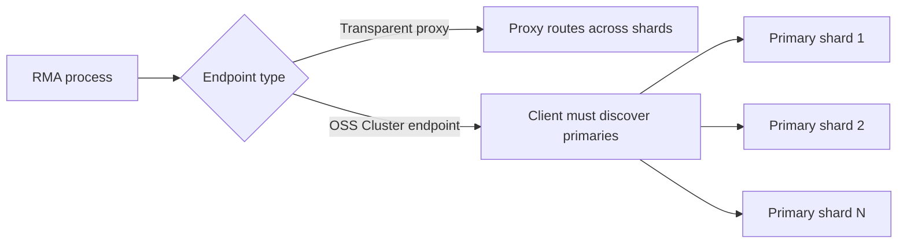
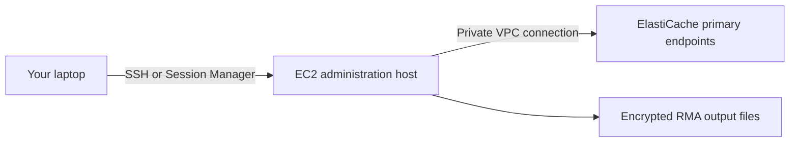

Redis is fast because its working dataset lives primarily in memory. That speed comes with a practical question: when a Redis deployment approaches its memory limit, which keys and key families are consuming the space?

This guide explains how to answer that question with Redis Memory Analyzer (RMA), including clustered deployments and a workflow that runs from an EC2 instance over SSH.

<Warning>
  RMA is a legacy tool. Prefer a maintained Redis client with verified TLS and provider-supported authentication for production. Use RMA for pattern estimates when you can run it on a dedicated administration host with a scoped, short-lived credential.
</Warning>

## Start with the memory model

The value stored by your application is only one part of Redis memory usage. A key consumes memory at several layers:

1. **Payload**: The bytes in strings, hash fields, list elements, sets, and sorted sets.
2. **Redis object overhead**: Metadata for the key, value type, encoding, expiration, and references.
3. **Allocator overhead**: The memory allocator reserves blocks that can be larger than the requested value.
4. **Process overhead**: Client buffers, replication buffers, Lua state, loaded modules, and internal dictionaries.
5. **Replication and clustering**: Replicas hold another copy of the dataset, and each shard has its own process overhead.
6. **Resident memory**: The operating system can report more resident memory than Redis has actively allocated because of fragmentation.

These layers answer different questions:

| Question | Best signal |
| --- | --- |
| Which key namespace dominates the dataset? | RMA pattern report |
| Which individual keys are largest? | `redis-cli --keystats` or `--memkeys` |
| How much memory has Redis allocated? | `INFO MEMORY` |
| How much RAM does the process occupy? | `used_memory_rss` and provider metrics |
| How close is the service to its configured limit? | Redis Enterprise, AWS, or Azure service metrics |

RMA is most useful for the first question. It scans keys, groups names such as `user:1001` and `user:1002` into a pattern such as `user:*`, and estimates the memory associated with each pattern.

## Understand what RMA does

RMA connects to one Redis endpoint and performs an incremental `SCAN`. For each discovered key, it inspects the type, encoding, and TTL. It then reads enough information to estimate useful bytes and allocator bytes for supported structures.

The tool supports these core types:

- Strings
- Hashes
- Lists
- Sets
- Sorted sets

It does not provide complete accounting for newer types and modules such as streams, JSON documents, search indexes, time series, or probabilistic structures. Its allocator model also predates modern Redis releases. This means the report is better for comparing namespaces than for producing an exact infrastructure bill.

<Info>
  `SCAN` avoids the single long blocking operation caused by `KEYS *`, but a complete scan is still `O(N)`. RMA also sends additional commands for the keys it discovers. A large run can create noticeable CPU, network, and command load.
</Info>

## Why a cluster changes the workflow

An endpoint does not always represent the whole logical database.



RMA uses a normal single-node Redis client. It does not maintain a Redis Cluster slot map or follow every shard automatically.

| Deployment | Endpoint behavior | RMA strategy |
| --- | --- | --- |
| Redis Enterprise standard database endpoint | Proxy hides the shards | Run once against the database endpoint |
| Redis Enterprise with OSS Cluster API | Client discovers multiple primaries | Run once per primary endpoint |
| AWS ElastiCache, cluster mode disabled | One primary shard | Run against the primary endpoint |
| AWS ElastiCache, cluster mode enabled | Configuration endpoint exposes cluster topology | Run once per primary node endpoint |
| Azure Managed Redis, Enterprise policy | One proxy endpoint | Run once against port `10000` |
| Azure Managed Redis, OSS policy | Client discovers shard ports | Discover current primaries and run once per primary |

If you scan only one primary in an OSS-style cluster, the report describes only that shard. It is not a report for the entire cluster.

## Plan a safe run

Before connecting RMA to production:

1. Confirm whether the endpoint is a proxy, a single primary, or a cluster discovery endpoint.
2. Record current CPU, command rate, latency, and memory metrics.
3. Start with a small `--limit`, such as `1000` keys.
4. Restrict the first run with `--match` or `--type` when possible.
5. Run during a quiet period.
6. Stop if latency or CPU moves outside your normal operating range.
7. Save one output file per shard so you know exactly what was scanned.

Do not use a reader endpoint for a complete RMA run. A reader endpoint can distribute connections across replicas, and RMA uses Lua and commands that can be restricted on read-only replicas.

## Install a reproducible RMA environment

The PyPI release does not include the final repository commit that added the `--ssl` flag. The following installation pins that commit and installs modern package names explicitly.

```bash
sudo apt-get update
sudo apt-get install -y git python3 python3-venv redis-tools

python3 -m venv ~/venvs/rma
source ~/venvs/rma/bin/activate

python -m pip install --upgrade pip
python -m pip install "redis>=5,<6" tabulate tqdm msgpack
python -m pip install --no-deps \
  "git+https://github.com/gamenet/redis-memory-analyzer.git@dd1e74994ae1d258b2bfca9cd226acb05b5516f5"

rma --help
```

The help output should include `--ssl`.

<Note>
  RMA accepts a password for the default user. Use a client that supports your authentication method if the deployment requires a separate ACL username or IAM authentication.
</Note>

## Verify the connection with a TLS tunnel

The RMA version above relies on redis-py 5.x, whose default TLS configuration checks the certificate chain but can skip the hostname check. Use a loopback-only `stunnel` listener to verify both before sending credentials to a remote Redis server. Run the tunnel and commands on the same dedicated administration host.

Install `stunnel4` on Debian or Ubuntu. Create `~/rma-tunnel.conf` with your Redis endpoint, port, and the CA bundle trusted for that endpoint. Use the provider's documented TLS server name for both `checkHost` and `sni`.

```ini
foreground = yes
pid =

[redis-rma]
client = yes
accept = 127.0.0.1:16379
connect = redis.example.internal:6379
CAfile = /etc/ssl/certs/ca-certificates.crt
verifyChain = yes
checkHost = redis.example.internal
sni = redis.example.internal
sslVersionMin = TLSv1.2
```

Set `CAfile` to your approved private CA bundle if the server uses a private CA. Start the tunnel as your normal user.

```bash
stunnel ~/rma-tunnel.conf
```

In a second shell, read the password without echoing it and test the connection through the loopback listener.

```bash
read -rsp "Redis password: " REDIS_PASSWORD
echo

REDISCLI_AUTH="$REDIS_PASSWORD" redis-cli -h 127.0.0.1 -p 16379 PING
REDISCLI_AUTH="$REDIS_PASSWORD" redis-cli -h 127.0.0.1 -p 16379 INFO memory
REDISCLI_AUTH="$REDIS_PASSWORD" redis-cli -h 127.0.0.1 -p 16379 DBSIZE
```

Expect `PONG` from `PING`. If the TLS connection fails, verify the endpoint name and CA bundle before proceeding. Stop the tunnel and unset `REDIS_PASSWORD` when you finish.

## Use a progressive RMA workflow

With the verified tunnel running, begin with pattern discovery over a small sample.

```bash
rma \
  --server 127.0.0.1 \
  --port 16379 \
  --password "$REDIS_PASSWORD" \
  --db 0 \
  --limit 1000 \
  --behaviour scanner
```

Increase the sample only after checking service metrics:

```bash
rma \
  --server 127.0.0.1 \
  --port 16379 \
  --password "$REDIS_PASSWORD" \
  --db 0 \
  --limit 10000 \
  --behaviour all
```

Target a namespace when you already have a suspect:

```bash
rma \
  --server 127.0.0.1 \
  --port 16379 \
  --password "$REDIS_PASSWORD" \
  --match "session:*" \
  --type hash \
  --behaviour ram
```

Save machine-readable output for comparison:

```bash
umask 077
mkdir -p ~/rma-output

rma \
  --server 127.0.0.1 \
  --port 16379 \
  --password "$REDIS_PASSWORD" \
  --limit 10000 \
  --format json \
  > "$HOME/rma-output/report-$(date +%Y%m%d-%H%M%S).json"
```

<Warning>
  RMA takes the expanded password as a process argument, where local processes with sufficient access can read it while RMA is running. For routine production reporting, use a maintained tool that accepts credentials without placing them in the process arguments. For an RMA run, use a dedicated administration host and a scoped, short-lived credential.
</Warning>

## Example: Redis Enterprise cluster

A standard Redis Enterprise database endpoint proxies requests to its shards. Configure the verified tunnel for the database hostname and TLS port. Use the database's trusted CA bundle, then preflight the connection and run the sample through the tunnel.

If the database uses the **OSS Cluster API**, discover the primary endpoints with a cluster-aware client. Configure and verify a separate tunnel for each primary before collecting its report.

## Example: AWS ElastiCache for Redis OSS

Run the tunnel from an EC2 administration host that can resolve and reach the private cache endpoints. Check that encryption in transit is enabled on the cache.

### Cluster mode disabled

Use the **Primary Endpoint** and its TLS port for the tunnel. The **Reader Endpoint** can distribute connections across replicas, which makes it unsuitable for a stable view of the primary keyspace.

### Cluster mode enabled

Use the AWS CLI to list the current primary endpoint and port for each shard.

```bash
aws elasticache describe-replication-groups \
  --replication-group-id my-cache \
  --query 'ReplicationGroups[0].NodeGroups[].[NodeGroupId,PrimaryEndpoint.Address,PrimaryEndpoint.Port]' \
  --output table
```

Point the verified tunnel at one primary at a time. Stop and restart it with the next primary's verified endpoint configuration before collecting another report. Save each JSON report under its shard ID and check service metrics after each small sample.

For deployments that require IAM authentication or a named ACL user, use a compatible Redis client such as `redis-cli` with the provider-supported authentication method.

## Example: Azure Managed Redis

Azure Managed Redis uses port `10000` for the initial endpoint. Run the tunnel from an administration host that can reach the cache.

### Enterprise cluster policy

The Enterprise policy provides a proxy endpoint. Configure the verified tunnel for that hostname and port `10000`, then run the preflight and sample through the local listener.

### OSS cluster policy

Use the verified tunnel to the initial endpoint to discover the topology.

```bash
REDISCLI_AUTH="$REDIS_PASSWORD" redis-cli -h 127.0.0.1 -p 16379 CLUSTER NODES
```

Record the current primary endpoints and their advertised client ports. Reconfigure and restart the tunnel for each primary before scanning it. Use a certificate name documented by the provider for that endpoint. If the endpoint's identity cannot be verified, stop and use a supported cluster-aware client.

## Run RMA by SSHing into an EC2 instance

This is the most common workflow for a private ElastiCache deployment:



### 1. Prepare network access

The EC2 instance should be in the same VPC as ElastiCache, or in a network connected through supported VPC routing. Configure the cache security group to accept the Redis port from the EC2 instance's security group. Avoid rules that expose Redis to the public internet.

### 2. Connect to EC2

```bash
ssh -i ~/.ssh/redis-admin.pem ec2-user@EC2_PUBLIC_DNS
```

For a private instance, connect through your approved bastion, VPN, or AWS Systems Manager Session Manager.

### 3. Install RMA

Follow the reproducible installation earlier in this guide. On Amazon Linux, use `dnf` packages that provide Python, Git, and `redis-cli` instead of the Ubuntu `apt-get` command.

### 4. Verify the route before scanning

Check DNS and TCP reachability from EC2 with `getent hosts "$REDIS_HOST"` and `nc -vz "$REDIS_HOST" "$REDIS_PORT"`, using the hostname and port in your tunnel configuration. Start the verified tunnel and run the loopback `PING` preflight. If DNS or TCP fails, check VPC DNS, security groups, network ACLs, routes, and the endpoint port. If the preflight fails after TCP succeeds, check TLS verification and authentication.

### 5. Keep the run alive safely

Use `tmux` so a laptop disconnect does not terminate the scan:

```bash
tmux new -s redis-rma
```

Run the small sample, inspect provider metrics, and then increase the limit. Detach with `Control+B`, then `D`. Reconnect later:

```bash
tmux attach -t redis-rma
```

### 6. Retrieve and clean up the report

From your laptop:

```bash
scp -i ~/.ssh/redis-admin.pem \
  ec2-user@EC2_PUBLIC_DNS:/home/ec2-user/rma-output/*.json \
  ./rma-output/
```

Treat reports as sensitive because key names can reveal tenant IDs, email-like identifiers, feature names, or internal architecture. Store them in an approved location and delete temporary copies from EC2 when the analysis is complete.

```bash
unset REDIS_PASSWORD
rm -rf ~/rma-output
deactivate
```

## Interpret the report

Focus on relationships, not false precision:

| Field | Interpretation |
| --- | --- |
| `Match` | The key-name pattern inferred by RMA |
| `Count` | Keys grouped into that pattern |
| `Useful` | Estimated application payload bytes |
| `Real` | Estimated allocated bytes after object and allocator overhead |
| `Ratio` | Estimated real bytes divided by useful bytes |
| `Encoding` | Internal encoding observed for the values |
| `TTL Min/Max/Avg` | Expiration behavior for the pattern |

Useful questions to ask:

- Does one namespace own most of the keys?
- Does a pattern have a high `Real` to `Useful` ratio because it contains many tiny values?
- Are large cache-like namespaces missing TTLs?
- Is one shard much larger than the others?
- Did a deployment or feature launch create a new namespace?

For a multi-shard cluster, compare reports per shard first. To obtain cluster-level pattern totals, add `Count`, `Useful`, and `Real` for the same pattern across all primary reports. Calculate averages as weighted averages rather than averaging each shard's average.

Do not use RMA's estimate as a replacement for `used_memory`, `used_memory_rss`, replication overhead, or provider capacity metrics.

## Cross-check with current Redis tooling

Use `redis-cli` through the verified tunnel to report on the same endpoint or each primary shard. The credential is supplied via the environment.

```bash
REDISCLI_AUTH="$REDIS_PASSWORD" redis-cli \
  -h 127.0.0.1 \
  -p 16379 \
  --keystats \
  --top 20 \
  -i 0.1
```

To run a different report, replace the report flags with `--memkeys`, `--bigkeys`, or `--scan --pattern "session:*"`. Use `-i 0.1` to introduce a short pause per batch when supported. These tools still scan the keyspace, so apply the same production precautions.

## Troubleshooting

### `MOVED` or `ASK` responses

You connected RMA to an OSS Cluster discovery endpoint. RMA does not follow the complete cluster topology. Discover the primaries and run one report per primary endpoint.

### `CROSSSLOT` errors

The scan is crossing Redis Cluster hash slots. Connect directly to one primary shard instead of the cluster discovery endpoint.

### TLS certificate verification fails

Confirm that the configured `checkHost` matches the Redis server certificate and that `CAfile` contains the approved CA for the endpoint.

### `NOPERM` or an unknown-command error

RMA uses commands including `SCAN`, `TYPE`, `OBJECT ENCODING`, `TTL`, `DBSIZE`, `INFO`, and Lua script execution. `CONFIG GET` and `DEBUG SDSLEN` provide extra details but can be disabled by managed services. Missing Lua or key-read permissions can stop the run; blocked `CONFIG` or `DEBUG` may only reduce detail.

### The RMA total does not match provider memory

This is expected. RMA estimates supported key structures. Provider memory also includes fragmentation, buffers, replication, modules, process overhead, and service-specific reservations.

### The output covers fewer keys than expected

Check the following:

- A `--limit` is still present.
- A `--match` filter is excluding keys.
- You scanned only one primary in a sharded cluster.
- Keys changed or expired during the scan.
- The selected database number is correct. OSS Cluster deployments normally use database `0`.

## Operational checklist

- [ ] Identify the endpoint and cluster policy.
- [ ] Enumerate all primary shards for OSS-style clusters.
- [ ] Confirm DNS, TCP, verified TLS, and authentication from the analysis host.
- [ ] Record baseline CPU, latency, command rate, and memory.
- [ ] Run `--limit 1000` first.
- [ ] Save one report per primary shard.
- [ ] Cross-check with `redis-cli --keystats` and provider metrics.
- [ ] Remove credentials and temporary reports after the analysis.
- [ ] Repeat from the same topology and time window when comparing runs.

## References

- [Redis Memory Analyzer source](https://github.com/gamenet/redis-memory-analyzer)
- [RMA package information](https://pypi.org/project/rma/)
- [stunnel server certificate verification](https://www.stunnel.org/auth.html)
- [Redis CLI memory analysis](https://redis.io/docs/latest/develop/tools/cli/)
- [Redis `SCAN` command behavior](https://redis.io/docs/latest/commands/scan/)
- [Redis Enterprise proxy policies](https://redis.io/docs/latest/operate/rs/databases/configure/proxy-policy/)
- [Redis Enterprise CLI and TLS connections](https://redis.io/docs/latest/operate/rs/references/cli-utilities/redis-cli/)
- [AWS ElastiCache endpoint types](https://docs.aws.amazon.com/AmazonElastiCache/latest/dg/Endpoints.html)
- [AWS EC2 and ElastiCache connectivity](https://docs.aws.amazon.com/AmazonElastiCache/latest/dg/compute-connection.html)
- [Azure Managed Redis architecture](https://learn.microsoft.com/en-us/azure/redis/architecture)
- [Connect to Azure Managed Redis](https://learn.microsoft.com/en-us/azure/redis/how-to-redis-access-data)
