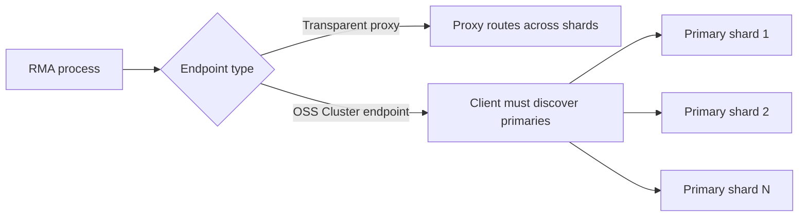
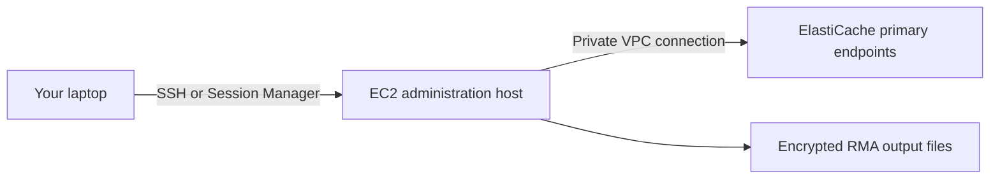

Redis is fast because its working dataset lives primarily in memory. That speed comes with a practical question: when a Redis deployment approaches its memory limit, which keys and key families are consuming the space?

This guide explains how to answer that question with Redis Memory Analyzer (RMA), including clustered deployments and a workflow that runs from an EC2 instance over SSH.

<Warning>
  RMA is a legacy community tool whose latest published work dates from 2020. Use its numbers as directional estimates, validate the workflow outside production first, and compare the result with current Redis and provider metrics.
</Warning>

## Start with the memory model

The value stored by your application is only one part of Redis memory usage. A key consumes memory at several layers:

1. **Payload**: The bytes in strings, hash fields, list elements, sets, and sorted sets.
2. **Redis object overhead**: Metadata for the key, value type, encoding, expiration, and references.
3. **Allocator overhead**: The memory allocator reserves blocks that can be larger than the requested value.
4. **Process overhead**: Client buffers, replication buffers, Lua state, loaded modules, and internal dictionaries.
5. **Replication and clustering**: Replicas hold another copy of the dataset, and each shard has its own process overhead.
6. **Resident memory**: The operating system can report more resident memory than Redis has actively allocated because of fragmentation.

These layers answer different questions:

| Question | Best signal |
| --- | --- |
| Which key namespace dominates the dataset? | RMA pattern report |
| Which individual keys are largest? | `redis-cli --keystats` or `--memkeys` |
| How much memory has Redis allocated? | `INFO MEMORY` |
| How much RAM does the process occupy? | `used_memory_rss` and provider metrics |
| How close is the service to its configured limit? | Redis Enterprise, AWS, or Azure service metrics |

RMA is most useful for the first question. It scans keys, groups names such as `user:1001` and `user:1002` into a pattern such as `user:*`, and estimates the memory associated with each pattern.

## Understand what RMA does

RMA connects to one Redis endpoint and performs an incremental `SCAN`. For each discovered key, it inspects the type, encoding, and TTL. It then reads enough information to estimate useful bytes and allocator bytes for supported structures.

The tool supports these core types:

- Strings
- Hashes
- Lists
- Sets
- Sorted sets

It does not provide complete accounting for newer types and modules such as streams, JSON documents, search indexes, time series, or probabilistic structures. Its allocator model also predates modern Redis releases. This means the report is better for comparing namespaces than for producing an exact infrastructure bill.

<Info>
  `SCAN` avoids the single long blocking operation caused by `KEYS *`, but a complete scan is still `O(N)`. RMA also sends additional commands for the keys it discovers. A large run can create noticeable CPU, network, and command load.
</Info>

## Why a cluster changes the workflow

An endpoint does not always represent the whole logical database.



RMA uses a normal single-node Redis client. It does not maintain a Redis Cluster slot map or follow every shard automatically.

| Deployment | Endpoint behavior | RMA strategy |
| --- | --- | --- |
| Redis Enterprise standard database endpoint | Proxy hides the shards | Run once against the database endpoint |
| Redis Enterprise with OSS Cluster API | Client discovers multiple primaries | Run once per primary endpoint |
| AWS ElastiCache, cluster mode disabled | One primary shard | Run against the primary endpoint |
| AWS ElastiCache, cluster mode enabled | Configuration endpoint exposes cluster topology | Run once per primary node endpoint |
| Azure Managed Redis, Enterprise policy | One proxy endpoint | Run once against port `10000` |
| Azure Managed Redis, OSS policy | Client discovers shard ports | Discover current primaries and run once per primary |

If you scan only one primary in an OSS-style cluster, the report describes only that shard. It is not a report for the entire cluster.

## Plan a safe run

Before connecting RMA to production:

1. Confirm whether the endpoint is a proxy, a single primary, or a cluster discovery endpoint.
2. Record current CPU, command rate, latency, and memory metrics.
3. Start with a small `--limit`, such as `1000` keys.
4. Restrict the first run with `--match` or `--type` when possible.
5. Run during a quiet period.
6. Stop if latency or CPU moves outside your normal operating range.
7. Save one output file per shard so you know exactly what was scanned.

Do not use a reader endpoint for a complete RMA run. A reader endpoint can distribute connections across replicas, and RMA uses Lua and commands that can be restricted on read-only replicas.

## Install a reproducible RMA environment

The PyPI release does not include the final repository commit that added the `--ssl` flag. The following installation pins that commit and installs modern package names explicitly.

```bash
sudo apt-get update
sudo apt-get install -y git python3 python3-venv redis-tools

python3 -m venv ~/venvs/rma
source ~/venvs/rma/bin/activate

python -m pip install --upgrade pip
python -m pip install "redis>=5,<6" tabulate tqdm msgpack
python -m pip install --no-deps \
  "git+https://github.com/gamenet/redis-memory-analyzer.git@dd1e74994ae1d258b2bfca9cd226acb05b5516f5"

rma --help
```

The help output should include `--ssl`.

<Note>
  The RMA CLI accepts a password but not an ACL username or a custom CA path. Deployments that require a non-default username, IAM-only authentication, or a private CA need an adapter or a different analysis tool.
</Note>

## Run a connection preflight

Set connection details without writing the password into your shell history:

```bash
export REDIS_HOST="redis.example.internal"
export REDIS_PORT="6379"
read -rsp "Redis password: " REDIS_PASSWORD
echo
```

Test DNS and TCP reachability first:

```bash
getent hosts "$REDIS_HOST"
nc -vz "$REDIS_HOST" "$REDIS_PORT"
```

Then test the Redis protocol. Use the TLS form when encryption in transit is enabled.

<CodeGroup>
```bash TLS
REDISCLI_AUTH="$REDIS_PASSWORD" redis-cli \
  -h "$REDIS_HOST" \
  -p "$REDIS_PORT" \
  --tls \
  PING
```

```bash Plain TCP
REDISCLI_AUTH="$REDIS_PASSWORD" redis-cli \
  -h "$REDIS_HOST" \
  -p "$REDIS_PORT" \
  PING
```
</CodeGroup>

Expected output:

```text
PONG
```

Check the database and memory view before scanning:

```bash
REDISCLI_AUTH="$REDIS_PASSWORD" redis-cli \
  -h "$REDIS_HOST" \
  -p "$REDIS_PORT" \
  --tls \
  INFO memory

REDISCLI_AUTH="$REDIS_PASSWORD" redis-cli \
  -h "$REDIS_HOST" \
  -p "$REDIS_PORT" \
  --tls \
  DBSIZE
```

## Use a progressive RMA workflow

Begin with pattern discovery over a small sample:

```bash
rma \
  --server "$REDIS_HOST" \
  --port "$REDIS_PORT" \
  --password "$REDIS_PASSWORD" \
  --ssl \
  --db 0 \
  --limit 1000 \
  --behaviour scanner
```

Increase the sample only after checking service metrics:

```bash
rma \
  --server "$REDIS_HOST" \
  --port "$REDIS_PORT" \
  --password "$REDIS_PASSWORD" \
  --ssl \
  --db 0 \
  --limit 10000 \
  --behaviour all
```

Target a namespace when you already have a suspect:

```bash
rma \
  --server "$REDIS_HOST" \
  --port "$REDIS_PORT" \
  --password "$REDIS_PASSWORD" \
  --ssl \
  --match "session:*" \
  --type hash \
  --behaviour ram
```

Save machine-readable output for comparison:

```bash
umask 077
mkdir -p ~/rma-output

rma \
  --server "$REDIS_HOST" \
  --port "$REDIS_PORT" \
  --password "$REDIS_PASSWORD" \
  --ssl \
  --limit 10000 \
  --format json \
  > "$HOME/rma-output/report-$(date +%Y%m%d-%H%M%S).json"
```

<Warning>
  RMA passes the password as a process argument. Another sufficiently privileged user on the same machine may be able to see it while the process runs. Use a dedicated administration host, a short-lived credential where supported, and remove the variable with `unset REDIS_PASSWORD` after the run.
</Warning>

## Example: Redis Enterprise cluster

Redis Enterprise Software places a proxy in front of database shards. A standard database endpoint routes commands to the correct shard, so a non-cluster-aware client can use one host and port.

Assume this example database endpoint:

```text
redis-db.internal.example.com:12000
```

Test the endpoint:

```bash
export REDIS_HOST="redis-db.internal.example.com"
export REDIS_PORT="12000"
read -rsp "Redis password: " REDIS_PASSWORD
echo

REDISCLI_AUTH="$REDIS_PASSWORD" redis-cli \
  -h "$REDIS_HOST" \
  -p "$REDIS_PORT" \
  --tls \
  --cacert /etc/ssl/redis/proxy_cert.pem \
  PING
```

If the certificate is already trusted by the operating system, run RMA directly:

```bash
rma \
  -s "$REDIS_HOST" \
  -p "$REDIS_PORT" \
  -a "$REDIS_PASSWORD" \
  --ssl \
  -l 5000 \
  -b all
```

If the database has the **OSS Cluster API** enabled, do not assume the first endpoint covers every shard. Discover the primary endpoints with a cluster-aware client and run RMA against each primary, just as you would for AWS cluster mode or Azure's OSS policy.

### Handle a private CA

RMA has no `--cacert` option. If Redis Enterprise uses a private or self-signed CA, terminate TLS locally with `stunnel` and point RMA at the local plaintext port.

```bash
sudo apt-get install -y stunnel4
```

Create `~/rma-stunnel.conf`:

```ini
client = yes
foreground = yes

[redis-rma]
accept = 127.0.0.1:16379
connect = redis-db.internal.example.com:12000
CAfile = /etc/ssl/redis/proxy_cert.pem
verifyChain = yes
checkHost = redis-db.internal.example.com
```

Start `stunnel` in one SSH session:

```bash
stunnel ~/rma-stunnel.conf
```

Run RMA from a second session without `--ssl` because the local tunnel handles TLS:

```bash
rma \
  -s 127.0.0.1 \
  -p 16379 \
  -a "$REDIS_PASSWORD" \
  -l 5000 \
  -b all
```

## Example: AWS ElastiCache for Redis OSS

ElastiCache normally lives in private VPC subnets. Run RMA from an EC2 instance that can resolve the endpoint and whose security group is allowed to reach the cache port.

### Cluster mode disabled

A cluster-mode-disabled replication group has one primary shard. Use its **Primary Endpoint** for the scan.

```bash
export REDIS_HOST="my-cache.xxxxxx.ng.0001.use1.cache.amazonaws.com"
export REDIS_PORT="6379"
read -rsp "ElastiCache auth token: " REDIS_PASSWORD
echo

REDISCLI_AUTH="$REDIS_PASSWORD" redis-cli \
  -h "$REDIS_HOST" \
  -p "$REDIS_PORT" \
  --tls \
  PING

rma \
  -s "$REDIS_HOST" \
  -p "$REDIS_PORT" \
  -a "$REDIS_PASSWORD" \
  --ssl \
  -l 5000 \
  -b all
```

Do not use the **Reader Endpoint**. It represents replicas, not a stable view of the primary keyspace for this workflow.

### Cluster mode enabled

The **Configuration Endpoint** lets a cluster-aware client discover the topology. RMA is not cluster-aware, so it must scan each primary node endpoint separately.

First, confirm cluster connectivity:

```bash
export CONFIG_ENDPOINT="my-cache.xxxxxx.clustercfg.use1.cache.amazonaws.com"

REDISCLI_AUTH="$REDIS_PASSWORD" redis-cli \
  -h "$CONFIG_ENDPOINT" \
  -p 6379 \
  --tls \
  -c \
  CLUSTER SHARDS
```

Use the AWS CLI to list the current primary endpoint for every shard:

```bash
aws elasticache describe-replication-groups \
  --replication-group-id my-cache \
  --query 'ReplicationGroups[0].NodeGroups[].[NodeGroupId,PrimaryEndpoint.Address,PrimaryEndpoint.Port]' \
  --output table
```

Create one JSON report per primary:

```bash
umask 077
OUT_DIR="$HOME/rma-output/aws-$(date +%Y%m%d-%H%M%S)"
mkdir -p "$OUT_DIR"

while read -r SHARD HOST PORT; do
  echo "Scanning shard $SHARD at $HOST:$PORT"
  rma \
    -s "$HOST" \
    -p "$PORT" \
    -a "$REDIS_PASSWORD" \
    --ssl \
    -l 5000 \
    -f json \
    > "$OUT_DIR/shard-$SHARD.json"
done < <(
  aws elasticache describe-replication-groups \
    --replication-group-id my-cache \
    --query 'ReplicationGroups[0].NodeGroups[].[NodeGroupId,PrimaryEndpoint.Address,PrimaryEndpoint.Port]' \
    --output text
)
```

Review service metrics after the sample. Remove `-l 5000` only when you are comfortable running a complete scan.

<Note>
  RMA accepts only a password. It cannot supply an ElastiCache ACL username or perform IAM authentication. Use a compatible default-user auth token for this specific workflow, or use `redis-cli --keystats` with supported authentication instead.
</Note>

## Example: Azure Managed Redis

Azure Managed Redis uses port `10000` for the initial endpoint and enables TLS by default. The correct workflow depends on the cluster policy.

### Enterprise cluster policy

The Enterprise policy presents a single proxy endpoint. RMA can treat it as one Redis endpoint.

```bash
export REDIS_HOST="mycache.eastus.redis.azure.net"
export REDIS_PORT="10000"
read -rsp "Azure Redis access key: " REDIS_PASSWORD
echo

REDISCLI_AUTH="$REDIS_PASSWORD" redis-cli \
  -h "$REDIS_HOST" \
  -p "$REDIS_PORT" \
  --tls \
  PING

rma \
  -s "$REDIS_HOST" \
  -p "$REDIS_PORT" \
  -a "$REDIS_PASSWORD" \
  --ssl \
  -l 5000 \
  -b all
```

Run this from a host with network access to the cache, such as a VM in the connected virtual network or an administration host reached through VPN or peering.

### OSS cluster policy

The OSS policy requires a cluster-aware client. The initial connection uses port `10000`, while direct shard connections use ports in the `85XX` range.

Discover the current topology before every run:

```bash
REDISCLI_AUTH="$REDIS_PASSWORD" redis-cli \
  -h "$REDIS_HOST" \
  -p 10000 \
  --tls \
  -c \
  CLUSTER NODES
```

For each line marked as a connected primary or `master`, record the advertised host and client port. Then run RMA separately against every primary:

```bash
rma \
  -s "PRIMARY_HOST" \
  -p "PRIMARY_PORT" \
  -a "$REDIS_PASSWORD" \
  --ssl \
  -l 5000 \
  -f json \
  > "azure-primary-01.json"
```

Repeat the command for every primary. Do not permanently store the `85XX` ports in a script because Azure can change them when topology changes.

## Run RMA by SSHing into an EC2 instance

This is the most common workflow for a private ElastiCache deployment:



### 1. Prepare network access

The EC2 instance should be in the same VPC as ElastiCache, or in a network connected through supported VPC routing. Configure the cache security group to accept the Redis port from the EC2 instance's security group. Avoid rules that expose Redis to the public internet.

### 2. Connect to EC2

```bash
ssh -i ~/.ssh/redis-admin.pem ec2-user@EC2_PUBLIC_DNS
```

For a private instance, connect through your approved bastion, VPN, or AWS Systems Manager Session Manager.

### 3. Install RMA

Follow the reproducible installation earlier in this guide. On Amazon Linux, use `dnf` packages that provide Python, Git, and `redis-cli` instead of the Ubuntu `apt-get` command.

### 4. Verify the route before scanning

```bash
getent hosts "$REDIS_HOST"
nc -vz "$REDIS_HOST" "$REDIS_PORT"

REDISCLI_AUTH="$REDIS_PASSWORD" redis-cli \
  -h "$REDIS_HOST" \
  -p "$REDIS_PORT" \
  --tls \
  PING
```

If DNS fails, inspect VPC DNS settings. If TCP fails, inspect security groups, network ACLs, routes, and the endpoint port. If `PING` fails after TCP succeeds, inspect TLS and authentication.

### 5. Keep the run alive safely

Use `tmux` so a laptop disconnect does not terminate the scan:

```bash
tmux new -s redis-rma
```

Run the small sample, inspect provider metrics, and then increase the limit. Detach with `Control+B`, then `D`. Reconnect later:

```bash
tmux attach -t redis-rma
```

### 6. Retrieve and clean up the report

From your laptop:

```bash
scp -i ~/.ssh/redis-admin.pem \
  ec2-user@EC2_PUBLIC_DNS:/home/ec2-user/rma-output/*.json \
  ./rma-output/
```

Treat reports as sensitive because key names can reveal tenant IDs, email-like identifiers, feature names, or internal architecture. Store them in an approved location and delete temporary copies from EC2 when the analysis is complete.

```bash
unset REDIS_PASSWORD
rm -rf ~/rma-output
deactivate
```

## Interpret the report

Focus on relationships, not false precision:

| Field | Interpretation |
| --- | --- |
| `Match` | The key-name pattern inferred by RMA |
| `Count` | Keys grouped into that pattern |
| `Useful` | Estimated application payload bytes |
| `Real` | Estimated allocated bytes after object and allocator overhead |
| `Ratio` | Estimated real bytes divided by useful bytes |
| `Encoding` | Internal encoding observed for the values |
| `TTL Min/Max/Avg` | Expiration behavior for the pattern |

Useful questions to ask:

- Does one namespace own most of the keys?
- Does a pattern have a high `Real` to `Useful` ratio because it contains many tiny values?
- Are large cache-like namespaces missing TTLs?
- Is one shard much larger than the others?
- Did a deployment or feature launch create a new namespace?

For a multi-shard cluster, compare reports per shard first. To obtain cluster-level pattern totals, add `Count`, `Useful`, and `Real` for the same pattern across all primary reports. Calculate averages as weighted averages rather than averaging each shard's average.

Do not use RMA's estimate as a replacement for `used_memory`, `used_memory_rss`, replication overhead, or provider capacity metrics.

## Cross-check with current Redis tooling

Run a current Redis CLI report against the same endpoint or each primary shard:

```bash
REDISCLI_AUTH="$REDIS_PASSWORD" redis-cli \
  -h "$REDIS_HOST" \
  -p "$REDIS_PORT" \
  --tls \
  --keystats \
  --top 20 \
  -i 0.1
```

Useful alternatives:

```bash
redis-cli --memkeys
redis-cli --bigkeys
redis-cli --scan --pattern "session:*"
```

Use `-i 0.1` to introduce a short pause per batch when supported. These tools still scan the keyspace, so apply the same production caution.

## Troubleshooting

### `MOVED` or `ASK` responses

You connected RMA to an OSS Cluster discovery endpoint. RMA does not follow the complete cluster topology. Discover the primaries and run one report per primary endpoint.

### `CROSSSLOT` errors

The scan is crossing Redis Cluster hash slots. Connect directly to one primary shard instead of the cluster discovery endpoint.

### TLS certificate verification fails

Confirm the hostname matches the certificate and that the CA is trusted by the operating system. For a private Redis Enterprise CA, use the verified `stunnel` pattern shown earlier.

### `NOPERM` or an unknown-command error

RMA uses commands including `SCAN`, `TYPE`, `OBJECT ENCODING`, `TTL`, `DBSIZE`, `INFO`, and Lua script execution. `CONFIG GET` and `DEBUG SDSLEN` provide extra details but can be disabled by managed services. Missing Lua or key-read permissions can stop the run; blocked `CONFIG` or `DEBUG` may only reduce detail.

### The RMA total does not match provider memory

This is expected. RMA estimates supported key structures. Provider memory also includes fragmentation, buffers, replication, modules, process overhead, and service-specific reservations.

### The output covers fewer keys than expected

Check the following:

- A `--limit` is still present.
- A `--match` filter is excluding keys.
- You scanned only one primary in a sharded cluster.
- Keys changed or expired during the scan.
- The selected database number is correct. OSS Cluster deployments normally use database `0`.

## Operational checklist

- [ ] Identify the endpoint and cluster policy.
- [ ] Enumerate all primary shards for OSS-style clusters.
- [ ] Confirm DNS, TCP, TLS, and authentication from the analysis host.
- [ ] Record baseline CPU, latency, command rate, and memory.
- [ ] Run `--limit 1000` first.
- [ ] Save one report per primary shard.
- [ ] Cross-check with `redis-cli --keystats` and provider metrics.
- [ ] Remove credentials and temporary reports after the analysis.
- [ ] Repeat from the same topology and time window when comparing runs.

## References

- [Redis Memory Analyzer source](https://github.com/gamenet/redis-memory-analyzer)
- [RMA package information](https://pypi.org/project/rma/)
- [Redis CLI memory analysis](https://redis.io/docs/latest/develop/tools/cli/)
- [Redis `SCAN` command behavior](https://redis.io/docs/latest/commands/scan/)
- [Redis Enterprise proxy policies](https://redis.io/docs/latest/operate/rs/databases/configure/proxy-policy/)
- [Redis Enterprise CLI and TLS connections](https://redis.io/docs/latest/operate/rs/references/cli-utilities/redis-cli/)
- [AWS ElastiCache endpoint types](https://docs.aws.amazon.com/AmazonElastiCache/latest/dg/Endpoints.html)
- [AWS EC2 and ElastiCache connectivity](https://docs.aws.amazon.com/AmazonElastiCache/latest/dg/compute-connection.html)
- [Azure Managed Redis architecture](https://learn.microsoft.com/en-us/azure/redis/architecture)
- [Connect to Azure Managed Redis](https://learn.microsoft.com/en-us/azure/redis/how-to-redis-access-data)
